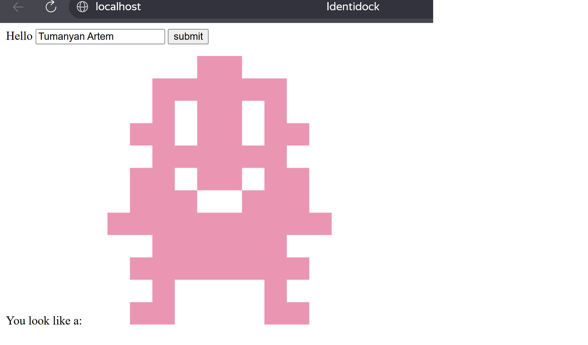
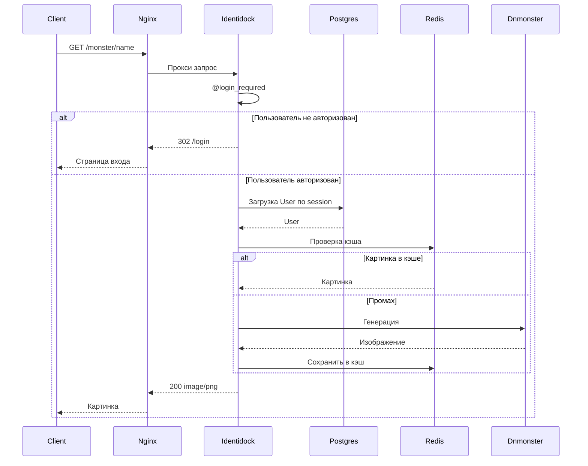
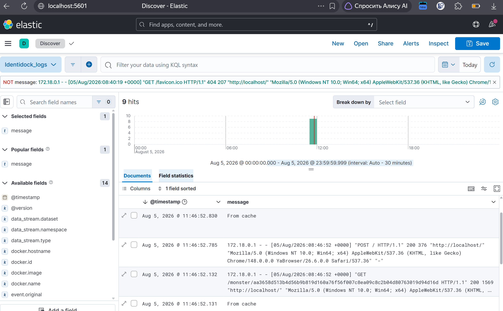
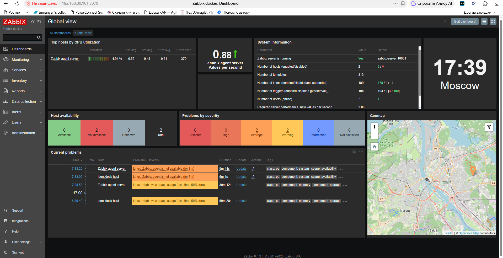
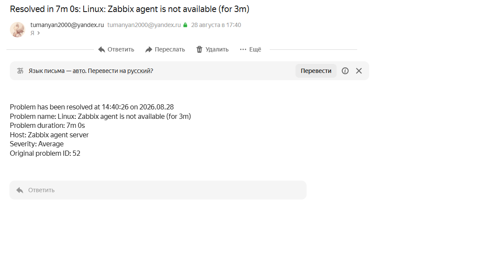
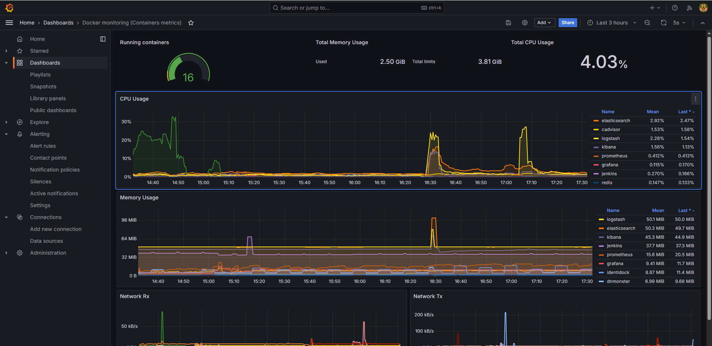
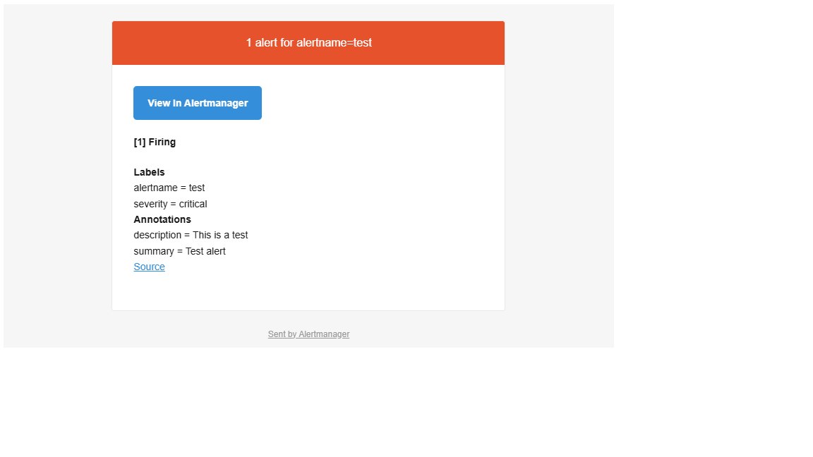

# Identidock

Веб-приложение с авторизацией: зарегистрированный пользователь вводит строку,<br>
приложение генерирует уникальное изображение (монстрика)<br>
<br><br>

---
<br>
## Архитектура окружений

В проекте настроены два независимых окружения:

- **DEV**: Запускается локально из исходников. Доступен по адресу `http://localhost:9001`. Использует Flask dev-сервер (с hot-reload).
- **PROD**: Запускается из готового Docker-образа (из Docker Hub) в папке `/opt/identidock-prod`. Доступен по адресу `http://localhost` (порт 80). Использует uWSGI.

---

## 🚀 Инструкция по развертыванию (Migration Guide)

Если вы переносите проект на новый сервер, выполните следующие шаги.

### 1. Предварительные требования
- Установлен Docker и Docker Compose.
- Создана внешняя сеть: `docker network create gitlab-net`.
- Открыты порты `80` (PROD), `9001` (DEV), `8929` (GitLab).

### 2. Развертывание GitLab и GitLab Runner
1. Перейдите в `ci-cd/gitlab/runner`.
2. Скопируйте `.env.example` в `.env` и заполните `RUNNER_TOKEN` (получить можно в GitLab -> Settings -> CI/CD -> Runners).
3. Запустите: `docker-compose up -d`.
*(Раннер автоматически подтянет DNS, проброс сокета и папки `/opt/identidock-prod` благодаря `config.template.toml`).*

### 3. Развертывание DEV окружения
1. В корне проекта скопируйте `.env.example` в `.env`. Сгенерируйте безопасный `SECRET_KEY` (`openssl rand -base64 32`).
2. Запустите: `docker-compose up -d`.
3. Проверка: `curl http://localhost:9001/healthz`.

### 4. Развертывание PROD окружения
1. Создайте папку `sudo mkdir -p /opt/identidock-prod` и выдайте права текущему пользователю (`sudo chown -R $USER:$USER /opt/identidock-prod`).
2. Скопируйте туда `.env.example` (из корня репозитория) и переименуйте его в `.env`. Заполните секреты.
   *(Файл `docker-compose.yml` копировать не нужно — CI автоматически использует версию из `ci-cd/gitlab/prod/docker-compose.yml`)*.
3. Запустите: `docker-compose up -d` (в первый раз можно поднять вручную, если CI ещё не настроен).
4. Проверка: `curl http://localhost/healthz`.
---

## ⚙️ CI/CD Пайплайн (GitLab)

Пайплайн запускается при каждом пуше в ветку.
- **lint**: Проверка кода flake8.
- **build**: Сборка Docker-образа.
- **test**: Запуск Unit-тестов и Healthcheck (с отдельной тестовой БД).
- **deploy** (manual): Пуш образа в Docker Hub и тегирование. При нажатии можно указать тег (по умолчанию `newest`).
- **verify**: Автоматический деплой на PROD (папка `/opt/identidock-prod`). Если Healthcheck не проходит — пайплайн падает.
- **rollback**: Если `verify` упал, автоматически откатывает PROD на предыдущий успешный тег и чинит тег `newest` на Docker Hub.
- **notify**: Отправка статуса в Telegram.

### Переменные CI/CD Gitlab (Settings -> CI/CD -> Variables)
Для работы пайплайна необходимо задать:
- `SECRET_KEY`, `POSTGRES_PASSWORD` (секреты БД).
- `DOCKER_USER`, `DOCKER_PASS` (для пуша в Docker Hub).
- `TELEGRAM_TOKEN`, `TELEGRAM_CHAT_ID` (для уведомлений).
- `PROD_DIR` = `/opt/identidock-prod`
- `PROD_HEALTHCHECK_URL` = `http://localhost/healthz`

---

## 📱 Telegram Уведомления и VPN

Сервер Astra находится в РФ, где доступ к `api.telegram.org` заблокирован. Для работы уведомлений на хосте настроен **AmneziaWG** (сплит-туннель только для подсетей Telegram).

### Как это устроено:
- Клиент AmneziaWG собирается из исходников (kernel-модуль).
- Конфиг лежит в `/etc/amnezia/amneziawg/wg0.conf`.
- Автозапуск: `systemctl enable amneziawg-quick@wg0`.
- Маршруты настроены только на IP Telegram (Docker Hub и PyPI ходят напрямую).

Если Telegram перестал работать, проверьте:
```bash
sudo awg show
# Должен быть latest handshake
```

---

**Для настройки мониторинга приложения** (ELK + logspout)<br>
6. Перейти в каталоги monitoring и выполнить сборку `docker-compose up -d`.<br>
Далее потребуется выбрать индекс в интерфейсе Elasticsearch

**Для настройки мониторинга инфраструктуры** (Zabbix Server + PostgreSQL + Web)<br>
7. Перейти в каталог monitoring/zabbix переименовать файл `.env_template` в `.env` и задать переменные.<br> 
Выполнить сборку `docker-compose up -d`.<br>
Установить zabbix агент на целевой хост:
```bash
wget https://repo.zabbix.com/zabbix/6.4/ubuntu/pool/main/z/zabbix-release/zabbix-release_6.4-1+ubuntu22.04_all.deb
sudo dpkg -i zabbix-release_6.4-1+ubuntu22.04_all.deb
sudo apt update
sudo apt install zabbix-agent -y
```
Далее в web-интерфейсе Zabbix http://localhost:8070 (логин: Admin, пароль: zabbix - по умолчанию, далее можно изменить) <br>
добавить хост с установленным агентом в Data Collection -> Hosts (т.к. zabbix устанавливается в docker, адрес хоста необходим в сети docker).<br>
Пример команды на хосте: `docker network inspect zabbix-net | grep Gateway`<br>
В интерефейсе можно также настроить Alerts -> Actions -> Trigger actions и Actions -> Media types для уведомлений<br>

**Для настройки сбора метрик и визуализации** (cAdvisor + Prometheus + Alertmanager + Node Exporter + Grafana).<br>
8. Перейти в каталог metrics переименовать файл `.env_template` в `.env` и задать переменные. <br> Выполнить сборку `docker-compose up -d` .<br><br>
Далее потребуется выбрать источники данных/настроить dashboards в интерфейсе Grafana.<br>
Для Node Exporter можно выбрать 1860.<br>
Для cAdvisor можно выбрать 14282.<br>

### Проверка работоспособности

- Приложение (PROD): http://localhost:80
- Приложение (DEV): http://localhost:9001
- Health-check (без авторизации): http://localhost:80/healthz → `{"status":"ok"}`
- Kibana: http://localhost:5601
- Elasticsearch: http://localhost:9200
- cAdvisor: http://localhost:8085
- Prometheus: http://localhost:9090
- Grafana: http://localhost:3000
- Zabbix: http://localhost:8070

---

### Технологии и инструменты
Работа основана на материале книги "Использование Docker".<br>

| Категория | Технологии |
|-----------|-----------|
| Языки | Python, Bash |
| Веб-фреймворк | Flask |
| Контейнеризация | Docker, Docker Compose |
| CI/CD | GitLab CI, Docker Hub |
| Мониторинг | ELK Stack (Elasticsearch, Logstash, Kibana), Logspout, Zabbix |
| Сбор метрик | cAdvisor, Prometheus, Grafana, Alertmanager, Node Exporter |
| Оркестрация | Ansible |
| Базы данных | Redis, PostgreSQL |
| Веб-сервер | Nginx, uWSGI |

<br><br>
***Схема работы приложения***


<br>

***Авторизация и пользователи***
- `Flask-Login` + сессионная cookie (`HttpOnly`, `SameSite=Lax`).
- Пароли — `werkzeug.security` (PBKDF2).
- Хранилище — PostgreSQL, доступ через `Flask-SQLAlchemy`.
- Миграции — `Flask-Migrate` (Alembic). В `ENV=UNIT` миграции пропускаются (см. `entrypoint.sh`), тесты создают схему через `db.create_all()`.
- CSRF — `Flask-WTF`; в `ENV=UNIT` отключается.
- Публичные маршруты: `/`, `/healthz`, `/login`, `/register`.
- Требуют авторизации: `/monster/<name>`, `/profile`.

***Сборка и запуск python приложения*** (identidock.py) в Docker-контейнере.<br>
Приложение написано на *Flask*. В качестве сервера используется *uWSGI*.<br><br>

***DEV/UNIT/PROD*** скрипт cmd.sh определяет в каком окружении будет запускаться приложение.<br><br>

***CI/CD pipeline*** использован *GitLab CI*.<br>
Использован подход Continuous Deployment.<br>
- При пуше в любую ветку запускаются линтеры и тесты.
- Деплой (пуш в Docker Hub) происходит вручную (кнопкой Play).
- После деплоя автоматически запускается `verify`, который обновляет PROD и проверяет Healthcheck.
- Если PROD не отвечает, запускается `rollback`, возвращающий предыдущую версию.

***Мониторинг приложения*** использован стек *ELK*.<br>
*Logspout* - собирает логи всех приложений на хосте.<br>
*Logstash* - фильтрует логи.<br>
*Elasticsearch* - хранит логи, создает индексы для быстрого поиска.<br>
*Kibana* - отображает логи для анализа.<br>

<br><br>

*Для создания backupов Elasticsearch:*<br>
1) Создать репозиторий 
```bash
curl -X PUT "localhost:9200/_snapshot/my_backup?pretty" \
  -H 'Content-Type: application/json' -d'
{
  "type": "fs",
  "settings": {
    "location": "/usr/share/elasticsearch/backups",
    "compress": true
  }
}'
```
2) Создать снэпшот 
```bash
curl -X PUT "localhost:9200/_snapshot/my_backup/snapshot_1?wait_for_completion=true&pretty"
```
3) Проверить созданные снэпшоты
```bash
curl -X GET "localhost:9200/_snapshot/my_backup/_all?pretty"
```
4) Пример команды для восстановления
```bash
curl -X POST "localhost:9200/_snapshot/my_backup/snapshot_1/_restore?wait_for_completion=true&pretty" \
  -H 'Content-Type: application/json' -d'
{
  "indices": "logs-generic-default",
  "include_global_state": true,
  "ignore_unavailable": true
}'
```

***Мониторинг инфраструктуры*** использован *Zabbix*. <br>
*Zabbix Agent* - установлен на хосте/ах, отправляет метрики. <br>
*Zabbix Web* - отображает собранные метрики. <br>

<br><br>
<br>

***Сбор метрик*** использована связка Prometheus + Grafana + Alertmanager.<br>
*cAdvisor* - собирает метрики всех контейнеров на хосте (CPU, память, сеть, диски)<br>
*Prometheus* - хранение и анализ временных рядов метрик, язык запросов PromQL<br>
*Grafana* - визулизация метрик, построение дашбордов<br>
*Alertmanager* - обработка и отправка алертов

<br><br>
<br>

***Настройка на нескольких хостах*** использован *Ansible*.<br>
Необходимо установить ansible на целевую машину - хост.<br>
Прокинуть ssh ключи на целевые машины (target, где должно рабоать приложение),<br>
скорректировать файл hosts (inventory) и актуализировав `NGINX_HOST`<br>
в `identidock.yml`.<br>
Далее можно будет вызвать:

```bash
ansible-playbook -i hosts identidock.yml
```
<br>Приложение будет развернуто на target хостах.

***Ротирование логов*** использован logrotate Linux.<br>
Если не настроено ротирование логов для Docker,<br>
то очень быстро закончится место на диске.<br>
В ОС Linux рекомендуется выполнить скрипт<br>
docker_logrotate.sh c root правами.

---
### Структура файлов
- **identidock/** - исходный код Flask-приложения
  - **app/identidock.py** - маршруты (`/`, `/monster/<name>`, `/profile`, `/healthz`)
  - **app/models.py** - модель `User`
  - **app/auth.py** - блупринт login/register/logout
  - **app/extensions.py** - `db`, `login_manager`, `migrate`, `csrf`
  - **app/tests.py** - unit-тесты (в т.ч. проверка `@login_required`)
  - **app/templates/** - `base.html`, `index.html`, `login.html`, `register.html`, `profile.html`
- **ci-cd/gitlab/** - GitLab CI (include-шаблоны, хелперы)
  - **runner/** - настройка GitLab Runner (config.template.toml)
  - **prod/** - эталонный docker-compose.yml для PROD окружения (используется CI)
- **identiproxy/** - конфигурация Nginx (балансировщик)
- **monitoring/** - конфигируция ELK (настройка парсинга логов, данные ELK, Logspout)
- **monitoring/zabbix** - конфигурация Zabbix
- **metrics/** - конфигурация метрик (cAdvisor, Prometheus, Grafana, Alertmanager)
- **usefull_scripts/** - опциональные скрипты для разового запуска
- **ansible_configuration/** - Ansible плейбуки для деплоя
- **screenshots/** - скриншоты для README
- **common.yml** - версии образов для сервисов приложения
- **.env.example** - шаблон переменных для DEV
- **docker-compose.yml** - (в /opt/identidock-prod) шаблон для PROD

---
### Известные проблемы и их решение

**Windows ошибка**: "exec /cmd.sh: no such file or directory".<br>
**Причина:** CRLF окончания строк в скриптах.<br>
**Решение:** Конвертируйте скрипты в формат LF<br>

```powershell
(Get-Content cmd.sh) -join "`n" | Set-Content -NoNewline cmd.sh
```

***Ошибка доступа к Docker Hub***
**Причина:** Не настроены credentials в GitLab Variables.<br>
**Решение:** Укажите свои логин (`DOCKER_USER`) и пароль/токен (`DOCKER_PASS`) в настройках CI/CD.<br>
<br>

---
## Ссылки
"Using Docker" by Adrian Mouat - https://files.znu.edu.ua/files/Bibliobooks/Inshi70/0051001.pdf
